<!-- BANNER IMAGE -->

  

#  

  
  

---

###  About me

  <table border="0">
    <tr>
      <td width="70%">
        <ul>
          <li>🎓 <b>Education:</b> Final-year Computer Engineering student specializing in Data Science & AI.</li>
          <li>💼 <b>Experience:</b> Internship @ NEXANS (Anomaly Detection).</li>
          <li>⚡ <b>Specialty:</b> Building end-to-end ML projects: data, model, explainability, API, deployment.</li>
          <li>🧪 <b>Background:</b> Preparatory cycle in Physics-Chemistry (Strong math/scientific foundations).</li>
        </ul>
      </td>
     
   
  </table>

---

### 🚀 Featured Projects

  <table border="0">
    <tr>
      <td width="50%">
        <b>🛡️ Network Intrusion Detection</b> 
        <i>Python, MLflow, Docker</i> 
        CESNET / CICIDS2017 classification utilizing a complete MLOps pipeline.
      </td>
      <td width="50%">
        <b>📈 EUR/TND Forecasting</b> 
        <i>PyTorch, Streamlit, SHAP</i> 
        Comparison of 5 DL models, integrated with SHAP explainability and a Streamlit app.
      </td>
    </tr>
    <tr>
      <td width="50%">
        <b>🤝 JobMatch AI</b> 
        <i>spaCy, Flutter</i> 
        NLP / NER based job matching system connected to a mobile application.
      </td>
      <td width="50%">
        <b>🧠 Stroke Severity Prediction</b> 
        <i>XGBoost, SMOTE</i> 
        Research-style ML pipeline generating a fuzzy severity index for patients.
      </td>
    </tr>
  </table>

---
## Tech Stack

**Languages & ML**

**Backend & Data**

**Frontend & Mobile**

**Tools**

---

## GitHub Stats

  

  

  
  

---

  <!-- GitHub Contribution Snake Animation -->
   
  <picture>
    <source media="(prefers-color-scheme: dark)" srcset="https://raw.githubusercontent.com/hiba255/hiba255/output/github-contribution-grid-snake-dark.svg">
    <source media="(prefers-color-scheme: light)" srcset="https://raw.githubusercontent.com/hiba255/hiba255/output/github-contribution-grid-snake.svg">
    
  </picture>

---

 

